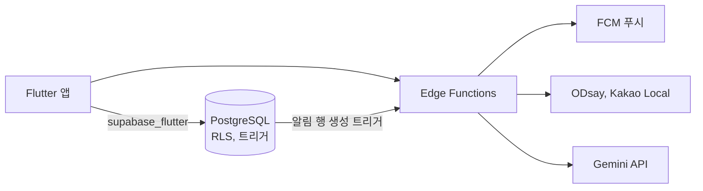

<div align="center">


# Calddy

캘린더에 일기와 친구 피드를 붙인 앱


2026년 1학기 캡스톤디자인, 4인 팀<br />
2026 KMAIA 하계학술대회에서 논문과 포스터를 발표했습니다

</div>

<br />


## 만든 이유

하루 기록은 여러 앱에 흩어져 있고, 약속을 잡을 때마다 서로 빈 시간을 묻느라 번거로웠습니다.
Calddy는 일정을 적는 캘린더와 하루를 남기는 일기를 한 앱에 합쳤습니다. 친구와 캘린더를 겹쳐 보고 약속도 여기서 잡습니다.

## 주요 기능

### 일정과 기록

일정, 반복 습관, 여러 날에 걸친 구간 일정을 따로 만듭니다. 일정이 끝나면 그날을 사진과 글로 기록하고 친구 피드에 올립니다. 날짜 칸에 직접 그림을 그려 꾸밀 수도 있습니다.


### 친구 캘린더 겹쳐 보기

친구들의 캘린더를 한 화면에 겹쳐 모두 비어 있는 날을 찾고, 그 자리에서 약속을 만듭니다. 초대받은 친구가 수락하면 그 친구의 캘린더에도 일정이 들어갑니다. 거절하면 다른 날짜를 제안할 수 있습니다.


### 중간 지점 찾기

각자 출발 장소를 넣으면 직선거리 대신 대중교통 이동 시간으로 중간 지점을 계산합니다. 근처 장소는 Gemini API로 추천합니다.


## 기술 스택

| 구분 | 사용한 것 |
| --- | --- |
| 앱 | Flutter, Riverpod, go_router |
| 백엔드 | Supabase (Auth, PostgreSQL, Storage, Realtime, Edge Functions) |
| 알림 | Firebase Cloud Messaging (HTTP v1) |
| 지도와 경로 | Naver Map, ODsay, Kakao Local API |
| 추천 | Gemini API |
| 테스트 | flutter_test, mocktail |

## 구조

별도 서버를 두지 않았습니다. 권한과 규칙은 Supabase RLS와 DB 트리거가 처리하고, 외부 API를 부르는 일만 Edge Function에 맡겼습니다.



예를 들어 친구가 약속 초대를 수락하면 `trg_invite_accepted` 트리거가 원래 일정을 그 친구의 캘린더에 복사합니다. 친구 요청이나 약속 초대가 들어오면 트리거가 `notifications`에 행을 만들고, `send-notification` 함수가 FCM으로 푸시를 보냅니다.

앱 코드는 기능별 폴더 안에서 Presentation, Domain, Data 레이어로 나눴습니다. 화면은 UseCase만 부르고, Supabase 클라이언트는 DataSource에서만 씁니다.

```
lib/
├── core/            라우터, 테마, 공통 에러 타입, UseCase 기반 클래스
└── features/
    ├── auth/        appointment/  calendar/  feed/  friend/
    ├── map/         notification/ report/    user/
    └── <기능>/
        ├── presentation/   페이지, 위젯, Riverpod Provider
        ├── domain/         Entity, Repository 인터페이스, UseCase
        └── data/           DataSource(Supabase), Model, Repository 구현

supabase/
├── migrations/      스키마, RLS 정책, 알림 트리거
└── functions/       calculate-midpoint, search-places, recommend-place,
                     send-notification, delete-account, delete-post
```

UseCase와 Repository 구현에 단위 테스트를 붙였습니다. `test/` 아래 파일 23개, 테스트 210개입니다.

## 맡은 일

4명이 앱 화면과 백엔드를 둘로 나눠 맡았습니다. 저([@lilohdong](https://github.com/lilohdong))는 백엔드 57개 기능 중 30개를 설계하고 구현했습니다.

- **Auth**: 이메일 가입과 OTP 인증, Google 로그인, 비밀번호 재설정, 약관 동의 저장
- **Calendar**: 일정, 습관, 구간 일정 CRUD와 월/주 통합 조회, 드로잉 저장, 공휴일
- **Appointment**: 초대와 수락, 수락 시 상대 캘린더에 일정 복제, 취소와 날짜 제안
- **Map**: 중간 지점 계산. 처음 계획한 Google Maps 대신 ODsay, Kakao Local API, Naver Map으로 다시 설계했습니다
- **Notification**: 알림 트리거와 FCM 발송 Edge Function

## 로컬에서 실행하기

[Flutter](https://docs.flutter.dev/get-started/install), [Supabase CLI](https://supabase.com/docs/guides/cli), Docker Desktop이 필요합니다.

```bash
# 1. Docker Desktop을 켠 뒤 로컬 Supabase 실행 (마이그레이션과 시드가 함께 들어감)
supabase start

# 2. 앱 환경 변수 파일 만들기
cp env.json.example env.json
#    SUPABASE_ANON_KEY 에 `supabase start`가 출력한 anon key를 넣는다
#    지도를 쓰려면 NAVER_MAP_CLIENT_ID 도 추가한다

# 3. 앱 실행
flutter pub get
flutter run --dart-define-from-file=env.json
```

Edge Function을 로컬에서 돌리려면 `supabase/functions/.env`에 아래 키를 넣고 `supabase functions serve`를 실행합니다.

`ODSAY_API_KEY`, `KAKAO_REST_API_KEY`, `GEMINI_API_KEY`, `FIREBASE_PROJECT_ID`, `FIREBASE_SERVICE_ACCOUNT_JSON`

테스트는 `flutter test`로 돌립니다.
