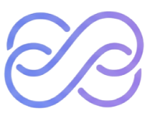
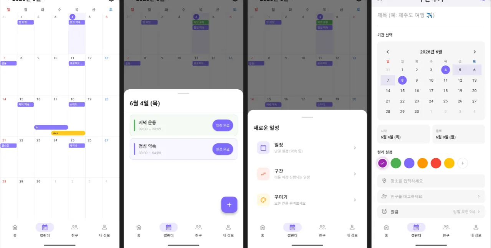
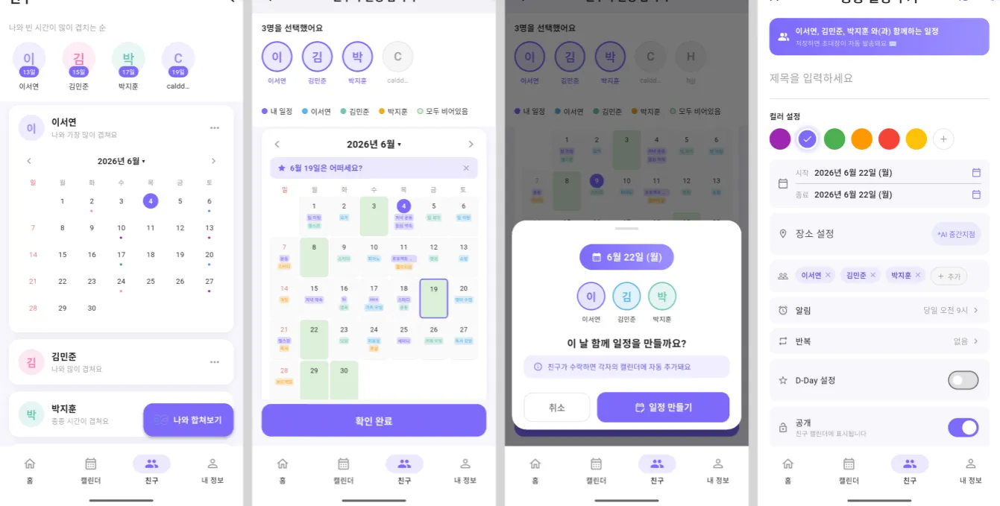
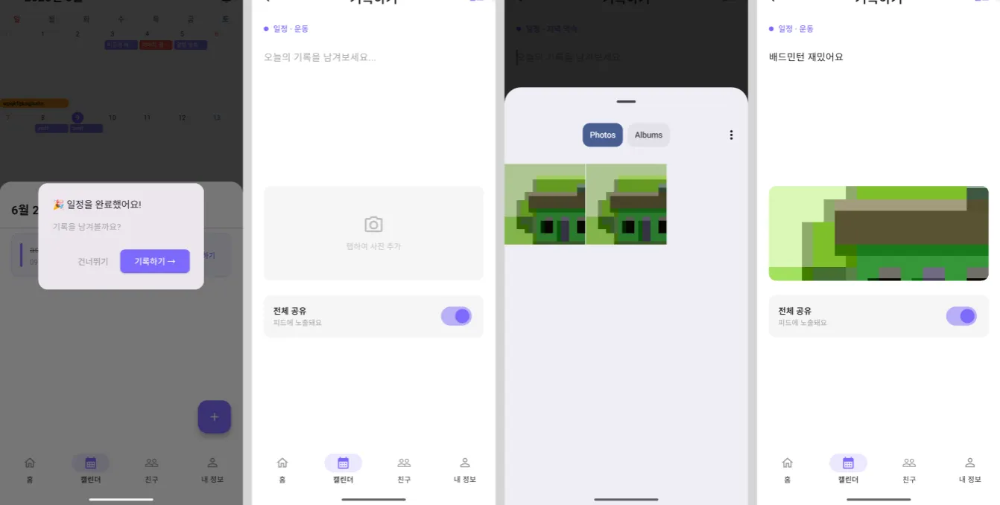
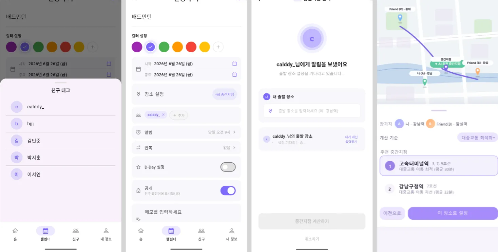
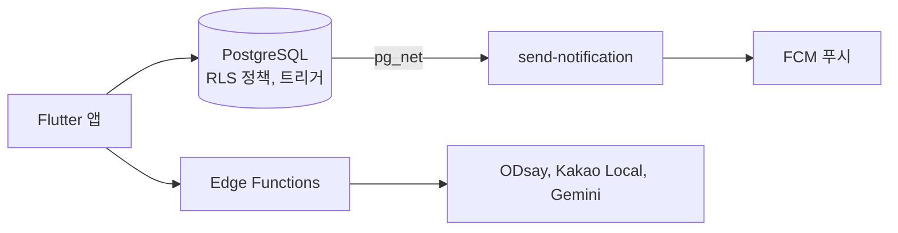

<div align="center">



# Calddy

캘린더에 일기와 친구 피드를 붙인 앱

<sub>Flutter, Supabase, FCM, Naver Map, ODsay, Kakao Local API, Gemini API</sub>

</div>

<br />



하루 기록은 여러 앱에 흩어지고, 약속을 잡을 때마다 서로 빈 시간을 묻는 게 번거로웠습니다.

그래서 캘린더 하나에 둘 다 넣었습니다. 일정이 끝나면 그날을 사진과 글로 남겨 친구 피드에 올립니다. 약속을 잡을 때는 친구들 캘린더를 겹쳐 보고 모두 비어 있는 날을 고릅니다. 만날 장소도 앱이 찾아 줍니다.

2026년 1학기 캡스톤디자인으로 4명이 만들었고, 2026 KMAIA 하계학술대회에서 논문과 포스터로 발표했습니다.

## 화면



친구를 고르면 함께 비는 날이 캘린더에 표시되고, 그 날짜로 바로 약속을 만듭니다. 초대받은 친구가 수락하면 친구 캘린더에도 같은 일정이 생깁니다.



끝난 일정에는 기록하기 버튼이 붙습니다.

## 중간 지점 찾기



지도 위 한가운데가 모두에게 가까운 곳은 아닙니다. 그래서 대중교통으로 걸리는 시간을 기준으로 잡았습니다.

`calculate-midpoint` 함수는 참여자 좌표의 평균에서 시작합니다. 그 지점까지 각자 몇 분 걸리는지 ODsay로 묻고, 가장 오래 걸리는 사람 쪽으로 지점을 조금 옮깁니다. 처음엔 20%, 다음엔 10%, 마지막엔 6.7%만큼 옮깁니다. 세 번 안에 이동 시간의 표준편차가 5분 이하로 내려가면 거기서 멈춥니다.

입력한 주소는 Kakao Local API로 좌표로 바꾸고, 결과는 Naver Map에 그립니다. 처음엔 Google Maps로 만들었다가 이 조합으로 다시 짰습니다. 장소 추천은 두 단계입니다. Gemini API가 중간 지점과 참여자 정보를 보고 검색어를 정하면, 그 검색어로 Kakao Local API에서 근처의 실제 가게를 찾습니다.

## 백엔드

API 서버를 따로 두지 않았습니다. 누가 어떤 행을 읽고 쓸 수 있는지는 Supabase RLS 정책에 적었고, 데이터가 바뀔 때 따라 일어나야 하는 일은 DB 트리거에 넣었습니다.



약속 초대를 수락하면 `trg_invite_accepted` 트리거가 원래 일정을 수락한 사람의 캘린더에 복사합니다. 약속이 취소되면 다른 트리거가 그 복사본을 지웁니다.

알림도 트리거에서 시작합니다. 친구 요청, 약속 초대, 좋아요, 댓글이 들어오면 트리거가 `notifications`에 행을 하나 쓰고, pg_net으로 `send-notification` 함수를 부릅니다. 그 함수가 FCM으로 휴대폰에 푸시를 보냅니다.

Edge Function은 외부 API 키가 필요한 일과 계정 삭제처럼 관리자 권한이 필요한 일에만 썼습니다.

## 코드 구조

```
lib/
├── core/                  라우터, 테마, 공통 에러 타입
└── features/
    ├── auth/  calendar/  appointment/  map/  notification/
    ├── feed/  friend/    user/         report/
    └── 기능마다
        ├── presentation/  화면과 Riverpod Provider
        ├── domain/        Entity, UseCase, Repository 인터페이스
        └── data/          Supabase를 부르는 DataSource와 Repository 구현

supabase/
├── migrations/            테이블, RLS 정책, 트리거
└── functions/             calculate-midpoint, search-places, recommend-place,
                           send-notification, delete-account, delete-post
```

화면 코드는 UseCase만 부르고, Supabase 클라이언트는 DataSource 밖으로 나가지 않게 했습니다. 팀 4명 모두 Flutter와 Supabase가 처음이라 이 규칙을 먼저 정해 두고 시작했습니다.

`test/` 아래에 테스트 210개가 있습니다.

## 실행

Flutter, [Supabase CLI](https://supabase.com/docs/guides/cli), Docker Desktop이 있어야 합니다.

```bash
# Docker Desktop을 켠 뒤 로컬 Supabase를 띄운다. 마이그레이션과 시드 데이터가 같이 들어간다
supabase start

# supabase start가 출력한 anon key를 env.json의 SUPABASE_ANON_KEY에 넣는다
# 지도를 쓰려면 NAVER_MAP_CLIENT_ID도 추가한다
cp env.json.example env.json

flutter pub get
flutter run --dart-define-from-file=env.json
```

중간 지점, 장소 검색, 푸시 알림은 Edge Function을 거칩니다. 로컬에서 쓰려면 `supabase/functions/.env`에 `ODSAY_API_KEY`, `KAKAO_REST_API_KEY`, `GEMINI_API_KEY`, `FIREBASE_PROJECT_ID`, `FIREBASE_SERVICE_ACCOUNT_JSON`을 넣고 `supabase functions serve`를 띄웁니다.

테스트는 `flutter test`로 돌립니다.

## 만든 사람

4명이 화면과 백엔드를 두 명씩 나눠 맡았습니다.

백엔드 57개 기능 중 30개는 [@lilohdong](https://github.com/lilohdong)이 설계하고 구현했습니다. 로그인과 회원가입, 캘린더, 약속 조율, 중간 지점, 알림이 여기에 들어갑니다.
